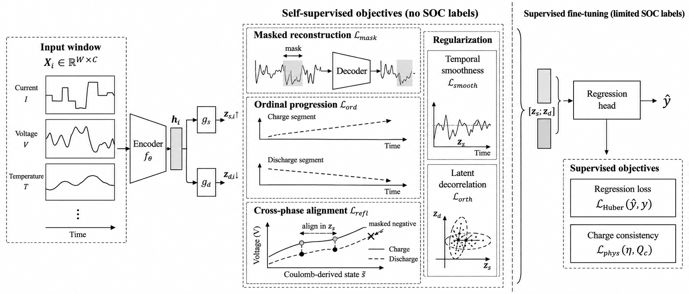
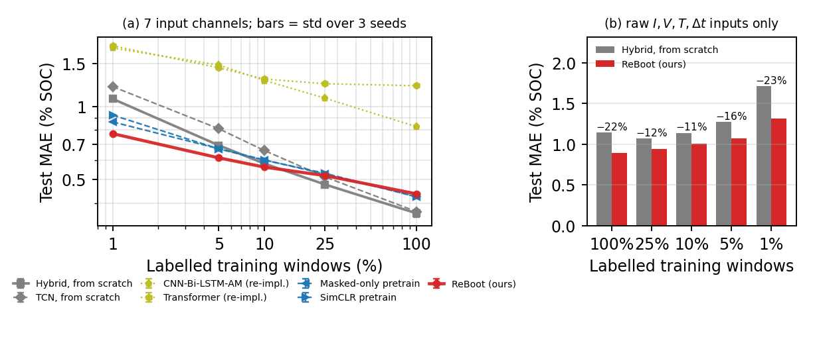
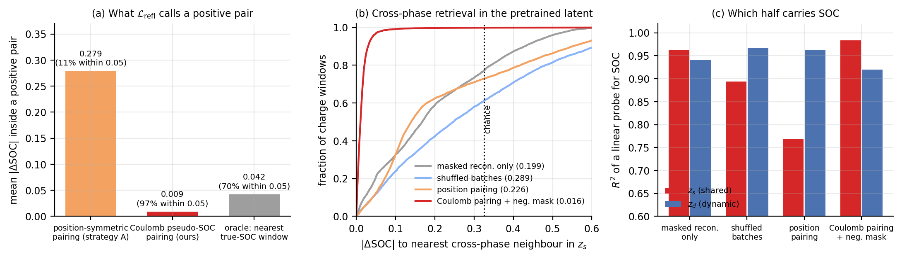

<div align="center">

# ReBoot — Physics-Structured Self-Supervised Pretraining for Label-Efficient Battery State-of-Charge Estimation

Marouane Tliba<sup>1,\*</sup> · Slimane Arbaoui<sup>2,\*</sup> · Youssra Taifour<sup>1</sup> · Mohamed Amine Kerkouri<sup>1,3</sup> · Marwa Zitouni<sup>2</sup> · Nour Aburaed<sup>4</sup> · Azeddine Beghdadi<sup>1</sup> · Aladine Chetouani<sup>1</sup> · Tedjani Mesbahi<sup>2</sup>

<sup>1</sup> Université Sorbonne Paris Nord · <sup>2</sup> INSA Strasbourg · <sup>3</sup> F-Initiative, ICUBE · <sup>4</sup> University of Dubai
<sub>\* equal contribution</sub>

**[Project page](https://mtliba.github.io/reboot/)** · **[Reproduction guide](docs/REPRODUCE.md)** · **[Supporting evidence](docs/EVIDENCE.md)** · **[All results](docs/RESULTS.md)**

</div>

---

> Accurate state-of-charge (SOC) estimation is essential for battery management, but data-driven
> models typically require densely labelled SOC trajectories that are difficult to obtain outside
> controlled laboratory conditions. We propose **ReBoot**, a physics-structured self-supervised
> pretraining framework for label-efficient SOC estimation from multivariate battery time series.
> ReBoot exploits two forms of label-free structure: monotonic SOC progression within charge and
> discharge segments, and cross-phase correspondence between windows at similar charge states
> despite hysteresis and phase-dependent dynamics. Pretraining combines an ordinal progression
> objective, cross-phase representation alignment, and masked signal reconstruction. Cross-phase
> pairs are constructed from a Coulomb-derived state coordinate used only during pretraining.
> On 19 cells spanning three temperatures and 2.9 M windows, ReBoot reduces test MAE by **28 % with
> 1 % labelled data** and **11 % with 5 %**, relative to the identical encoder trained from scratch.
> Using only raw *I, V, T, Δt* inputs, pretraining improves the same encoder across all label
> fractions by **12–23 %**. Ablations identify cross-phase alignment as the dominant structured
> objective in the low-label regime.

<p align="center"></p>

## At a glance

| | |
|---|---|
| **Task** | SOC regression from `(I, V, T, Δt)` windows, `W = 100`, stride 32 |
| **Data** | 19 LFP (LiFePO₄) cells ≈ 1.2 Ah, 25/35/45 °C, WLTC-based discharge, 39 634 cycles, 2.88 M windows |
| **Stage 1** | label-free pretraining: `L_mask + L_ord + L_refl + L_smooth + L_orth` |
| **Stage 2** | fine-tuning: `Huber(0.05) + 0.01 · L_phys` with learnable `η`, per-cell `Q_c` |
| **Headline** | −28 % MAE at 1 % labels, −11 % at 5 %, −12…23 % at *every* fraction with raw inputs |
| **Compute** | 200-epoch pretrain ≈ 9 h on 2× A100; each fine-tune ≈ 30 min on 1× A100 |

## What is in this repository

```
reboot/          the method: data pipeline, five pretraining losses, encoders, training modules
configs/         Hydra configs — every default in the paper is the committed default
scripts/         prepare_data, pretrain, finetune, evaluate, collect_results, make_evidence_figures
slurm/           the exact job scripts used for every run reported in the paper
tests/           unit tests, one per loss, matching the verification blocks in the spec
results/         every evaluation metric behind the tables (145 runs), learned physics parameters,
                 and 12 k held-out windows embedded by each pretrained encoder
docs/            project page, reproduction guide, extended results, supporting evidence
```

Nothing in `results/` is hand-edited: `scripts/collect_results.py` builds the paper tables from the
per-run `eval_metrics*.json` files, and `scripts/make_evidence_figures.py` rebuilds every analysis
figure in [`docs/EVIDENCE.md`](docs/EVIDENCE.md) from the committed artefacts.

## Results

### Table 1 — Test MAE (% SOC) versus labelled-data fraction

Input sets differ across groups; pretraining budgets are specified where applicable.
**Bold** denotes the best result within the matched 7-channel comparison.

| Model | 100 % | 25 % | 10 % | 5 % | 1 % |
|---|---|---|---|---|---|
| *Supervised, from scratch* | | | | | |
| TCN [20] | 0.369 | 0.513 | 0.658 | 0.810 | 1.208 |
| Hybrid (ReBoot encoder) | **0.363** | **0.477** | 0.581 | 0.692 | 1.076 |
| *Published SOC architectures, re-implemented* | | | | | |
| DNN [6] | 1.396 | 1.933 | 2.095 | 2.244 | 2.488 |
| LSTM-RNN [4] | 1.593 | 1.734 | 1.859 | 1.975 | 2.278 |
| GRU-RNN [5] | 1.226 | 1.442 | 1.745 | 1.852 | 2.178 |
| Transformer [7] | 1.219 | 1.242 | 1.298 | 1.444 | 1.781 |
| CNN-Bi-LSTM-AM [8] | 0.825 | 1.082 | 1.281 | 1.483 | 1.743 |
| *Self-supervised baselines, same encoder (100 ep.)* | | | | | |
| Masked reconstruction [11] | 0.425 | 0.527 | 0.602 | 0.670 | 0.864 |
| SimCLR-style contrastive [12] | 0.424 | 0.531 | 0.601 | 0.669 | 0.922 |
| *ReBoot* | | | | | |
| Position-based pairing | 0.393 | 0.478 | **0.536** | **0.600** | 0.813 |
| Coulomb pairing + mask (200 ep.) | 0.436 | 0.519 | 0.562 | 0.614 | **0.773** |
| *Raw I, V, T, Δt only* | | | | | |
| Hybrid, from scratch | 1.141 | 1.068 | 1.139 | 1.275 | 1.713 |
| ReBoot (100 ep.) | 0.890 | 0.943 | 1.008 | 1.074 | 1.313 |

### Table 2 — Ablation on the in-distribution split (100-epoch pretraining unless stated)

| Variant | 100 % | 1 % |
|---|---|---|
| Full ReBoot, 100 ep. | 0.438 | 0.781 |
| − `L_refl` | 0.444 | 0.921 |
| − `L_ord` | 0.436 | 0.798 |
| − `L_phys` | 0.414 | 0.817 |
| Single latent | 0.450 | 0.758 |
| `L_mask` only | 0.425 | 0.864 |
| SimCLR-style | 0.424 | 0.922 |
| Full ReBoot, 200 ep. | 0.434 | 0.773 |

Removing cross-phase alignment is by far the most damaging single change at 1 % labels
(0.781 → 0.921, +18 %).

<p align="center"></p>

The full 145-run result set — four evaluation protocols, three seeds, pretraining-pool and
loss-weight sweeps, linear probes, and per-phase / per-temperature / per-cell / per-decile error
breakdowns — is in [`docs/RESULTS.md`](docs/RESULTS.md) and `results/results*.csv`.

## Supporting evidence

[`docs/EVIDENCE.md`](docs/EVIDENCE.md) verifies, directly on the pretrained latents, that the
mechanism claimed in the paper is the mechanism that actually fires.

<p align="center"></p>

* Positive pairs built from the Coulomb-derived coordinate sit **0.009 SOC apart** (97 % within
  0.05); the position-symmetric construction the method was first written with sits **0.279 apart**
  (11 % within 0.05) — worse than an oracle that is allowed to look at labels (0.042).
* In the resulting latent, the nearest cross-phase neighbour of a charge window is **0.016 SOC**
  away (96.8 % within 0.05) against **0.327 at chance**. With position pairing the same measurement
  gives 0.226 — statistically indistinguishable from doing nothing.
* SOC information moves into the shared half exactly as the factorisation intends:
  `R²(SOC | z_s)` rises 0.77 → 0.98 while `R²(SOC | z_d)` falls 0.96 → 0.92.

Reference SOC is used **only to measure** these quantities. No pretraining stage ever reads a label.

## Installation

```bash
git clone https://github.com/mtliba/reboot.git && cd reboot
uv venv && uv pip install -e ".[dev]"     # or: pip install -e ".[dev]"
pytest -q                                  # CPU-only, no data needed
```

Requires Python ≥ 3.10, PyTorch ≥ 2.1, PyTorch Lightning ≥ 2.1, Hydra.

## Quick start

```bash
# 0. (no data yet) synthetic smoke test — exercises the whole pipeline end to end
python scripts/generate_synthetic_data.py && python scripts/prepare_data.py data.raw_dir=data/synthetic

# 1. window + scale the real cells, then build the memmap the samplers read
python scripts/prepare_data.py data.raw_dir=/path/to/raw
python scripts/build_memmap.py

# 2. pretrain, no labels (published recipe is the committed default)
python scripts/pretrain.py trainer.max_epochs=200 trainer.precision=32 \
    pretrain.batch_size=2048 pretrain.lr=1e-3

# 3. fine-tune on 1 % of the labels and evaluate
python scripts/finetune.py "finetune.pretrained_ckpt='<ckpt>'" finetune.label_fraction=0.01
python scripts/evaluate.py "+eval.ckpt='<ckpt>'" +eval.protocol=per_cell_random
```

Every number in the paper, with the exact command that produced it, is in
[`docs/REPRODUCE.md`](docs/REPRODUCE.md).

## Data

The cells are the LFP cycling campaign of Arbaoui et al. [19]. This repository ships the code,
the configs, the per-run metrics and the latent exports, **not** the raw measurements; please
contact the dataset authors for those. `scripts/prepare_data.py` expects one CSV per cell with
columns `time, I, V, T` (and an SOC column for fine-tuning), and
`scripts/generate_synthetic_data.py` produces a stand-in with the same schema so the pipeline and
all tests run without it.

## Known limitations (reported in the paper)

* The benefit of pretraining is concentrated below ~10 % labels; the crossover against training
  from scratch lies between 10 % and 25 %, and at full supervision ReBoot is behind.
* Under cross-cell and later-life (cross-cycle) shift ReBoot gives little improvement — its
  contribution is label efficiency, not domain adaptation.
* The shared/dynamic factorization is not what buys the accuracy: a single-latent variant matches
  it at 1 % labels (0.758 vs 0.781). It is the structure the objectives are defined on
  (see [`docs/EVIDENCE.md`](docs/EVIDENCE.md#3-the-factorisation-does-what-it-is-designed-to-do)).

## Citation

```bibtex
@inproceedings{tliba2026reboot,
  title     = {Physics-Structured Self-Supervised Pretraining for
               Label-Efficient Battery State-of-Charge Estimation},
  author    = {Tliba, Marouane and Arbaoui, Slimane and Taifour, Youssra and
               Kerkouri, Mohamed Amine and Zitouni, Marwa and Aburaed, Nour and
               Beghdadi, Azeddine and Chetouani, Aladine and Mesbahi, Tedjani},
  booktitle = {IEEE International Conference on Acoustics, Speech and Signal Processing (ICASSP)},
  year      = {2026}
}
```

## License

Code released under the MIT License (see [`LICENSE`](LICENSE)). The battery dataset is not
redistributed here and remains under its own terms.
