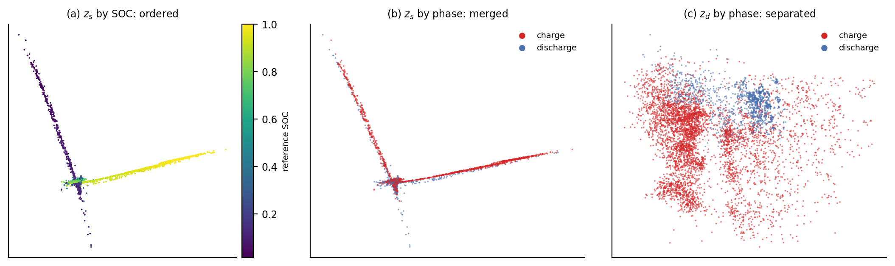
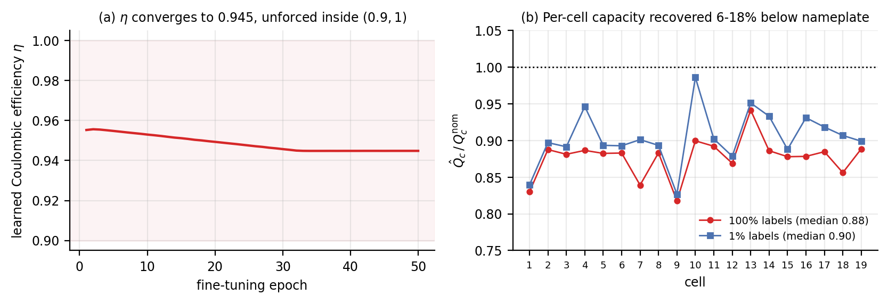
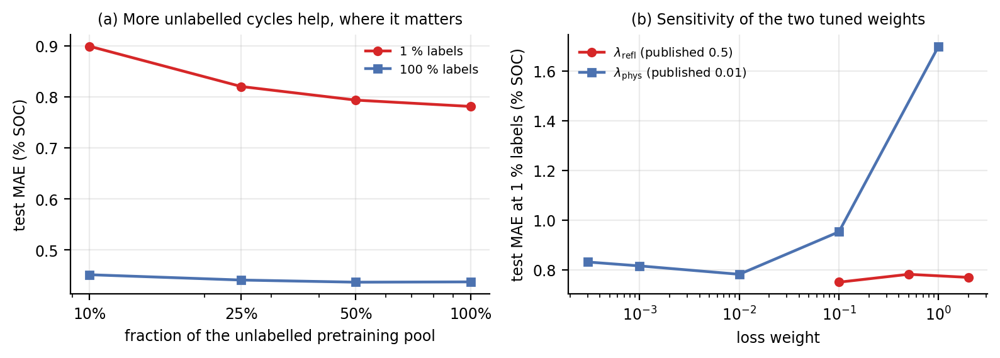
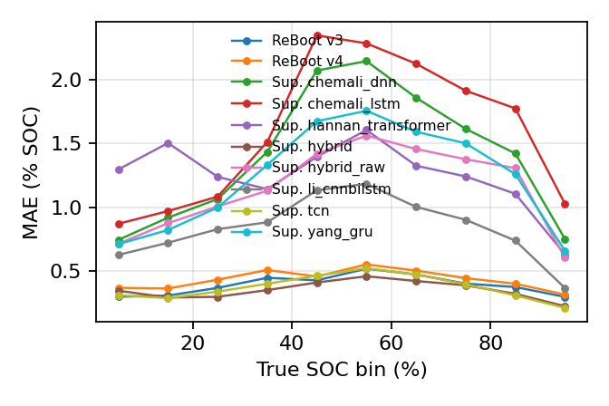
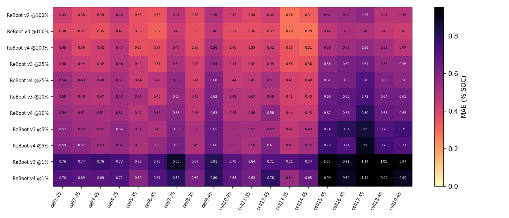
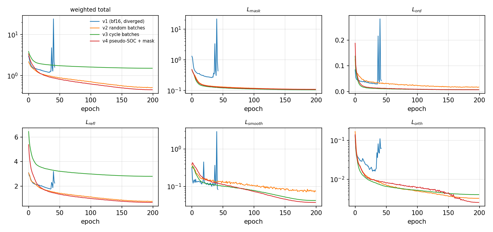

# Supporting evidence

Everything on this page is recomputed from artefacts committed in `results/` by

```bash
python scripts/make_evidence_figures.py
```

It is additional to the five-page paper, not a restatement of it. Each section answers a question a
careful reader of the paper would ask next.

> **On the use of labels.** Reference SOC appears on this page only as a *measuring stick*. No
> pretraining stage — pairing, negative masking, batch construction, or any of the five losses —
> ever reads a label. The pairing coordinate `s̃` is cumulative charge normalised inside each
> battery–cycle record, which is computable from the current trace alone.

---

## 1. The claimed mechanism is the mechanism that fires

The paper's central methodological claim is that cross-phase alignment needs a *physically
meaningful* notion of "the same state", and that the obvious geometric one does not supply it.
That claim is testable without training anything downstream.


**(a) What the objective is told is a positive pair.** Scoring, against reference SOC, the pairs
that each strategy actually hands to `L_refl` over 20 cycle-grouped batches of 2048 windows:

| pairing strategy | pairs / batch | mean &#124;ΔSOC&#124; | median | within 0.05 | same cycle |
|---|---|---|---|---|---|
| position-symmetric (`boundary_symmetric`) | 1578 | 0.279 | — | 11 % | 100 % |
| **Coulomb pseudo-SOC (`soc_proxy`, ours)** | 1596 | **0.009** | — | **97 %** | 4 % |
| oracle: nearest true-SOC window in the same cycle | 1578 | 0.042 | — | 70 % | 100 % |

The position-symmetric construction — pair the charge window at relative position *p* with the
discharge window at 1 − *p* — is the natural reading of "charging run in reverse". On these cells it
is wrong by 0.279 SOC on average, because multi-step fast charging makes charge segments two to
three times longer than the WLTC discharge segments they are matched against. The Coulomb-derived
coordinate is not merely better than that: at 0.009 it beats the *label-using* oracle restricted to
the same cycle (0.042), because it can pair across cycles. `corr(s̃, SOC) = 0.997` on 200 k windows.

Roughly 10 % of in-batch candidate negatives lie within 0.05 SOC of the anchor, so a plain InfoNCE
denominator actively pushes apart windows describing the same state; `s̃` is reused, label-free, to
drop them.

**(b) Does the pretrained latent end up aligned?** For each held-out charge window we retrieve its
nearest *discharge* window in centred `z_s` under cosine similarity, then measure how far apart the
two truly are. 6000 charge against 6000 discharge windows, 12 k held-out windows per checkpoint:

| pretrained encoder | mean &#124;ΔSOC&#124; to NN | within 0.05 | R²(SOC &#124; z_s) | R²(SOC &#124; z_d) |
|---|---|---|---|---|
| chance | 0.327 | — | — | — |
| masked reconstruction only | 0.199 | 21 % | 0.963 | 0.940 |
| shuffled batches | 0.289 | 12 % | 0.894 | 0.967 |
| cycle batches + position pairing | 0.226 | 12 % | 0.769 | 0.963 |
| **cycle batches + Coulomb pairing + negative mask** | **0.016** | **97 %** | **0.983** | 0.919 |

With position pairing, `L_refl` converges happily and produces *no* cross-phase alignment: 0.226
against 0.327 at chance. With the Coulomb coordinate the same loss, same encoder, same schedule
produces 0.016 — a 20× reduction, and a latent in which charge and discharge windows at equal SOC
are genuinely neighbours.

**Why this matters for the paper.** It separates two explanations of the 28 % low-label gain that
MAE alone cannot separate: "contrastive pretraining is a good regulariser" versus "cross-phase
alignment is being learned". The ablation (`−L_refl`: 0.781 → 0.921 at 1 %, the largest single
degradation) says the term matters; this measurement says *what* it does.

---

## 2. Cross-phase alignment is not something generic SSL gets for free

Masked reconstruction, under identical architecture, budget and data, reaches a retrieval gap of
0.199 — better than chance but nowhere near matched. SimCLR-style pretraining with random crops and
masking as augmentations is similar. This is the representational counterpart of the matched-budget
MAE comparison in Table 2 (ReBoot 0.781 vs masked 0.864 vs SimCLR 0.922 at 1 % labels): the
battery-structured objectives add something the generic objectives do not contain.

---

## 3. The factorisation does what it is designed to do

The paper reports, honestly, that a single-latent variant is *not* worse at 1 % labels
(0.758 vs 0.781). That invites the objection that the shared/dynamic split is decorative. It is not:
it is the coordinate system the objectives are written in, and it behaves exactly as specified.



Two-dimensional PCA of each half of the latent for the published model. `z_s` orders SOC
monotonically **and** puts charge and discharge windows on the same arms of the manifold — which is
precisely what `L_ord` and `L_refl` ask for. `z_d`, which no alignment term ever touches, is where
the phase separates. Quantitatively, switching from position to Coulomb pairing moves SOC information into the shared
half (`R²(SOC | z_s)`: 0.77 → 0.98) and out of the dynamic half (0.96 → 0.92).

So the right claim — the one the paper makes — is that the factorization supplies the structure the
objectives operate on, not that it is itself responsible for the accuracy.

---

## 4. The physics term recovers physically plausible constants

`L_phys` carries two free parameters per fine-tuning run: a Coulombic efficiency `η = 0.9 + 0.1·σ(α)`
and a per-cell capacity `Q_c`, log-parameterised and initialised at nameplate. If the term were
merely an output-smoothness penalty, these would drift anywhere inside their range.



They do not. `η` settles at **0.945**, in the middle of its admissible band and in the range reported
for LFP cells, and converges from both the 100 % and the 1 % label runs. The learned capacities land
**6–18 % below nameplate** at full supervision, consistently across all 19 cells, with the same ordering at 1 % labels
(median ratio 0.90) as at 100 % (median 0.88) — the expected signature of cells that have been cycled
and of usable capacity measured under a WLTC load rather than at the nameplate rate. Raw values for
every run are in `results/physics_params.json`.

The ablation is consistent with this being a real constraint rather than a free parameter:
removing `L_phys` costs 0.817 vs 0.781 at 1 % labels, while *improving* full-label MAE
(0.414 vs 0.438) — a physics prior helps exactly when there is not enough supervision to learn the
dynamics from labels, and mildly constrains the fit when there is.

---

## 5. The gain scales with unlabelled data, and the recipe is not knife-edge



**(a)** Cutting the unlabelled pretraining pool to 10 %, 25 % and 50 % of the available cycles
raises 1 %-label MAE from 0.781 to 0.794, 0.820 and 0.899, while barely moving the 100 %-label
number (0.438 → 0.437, 0.441, 0.452). The benefit grows with unlabelled data precisely in the
regime where the method claims one — the signature of a pretraining effect rather than a lucky
initialisation, and the reason the approach is worth the extra 9 GPU-hours when labels are the
scarce resource.

**(b)** Both tuned weights sit on flat parts of their curves. `λ_refl` moves 1 %-label MAE over
0.750–0.781 across a 20× range; `λ_phys` is flat from 0 to 0.01 and only degrades once the physics
term starts to compete with the regression objective (0.952 at 0.1, 1.700 at 1.0). Note that the
published `λ_refl = 0.5` is *not* the best point in its sweep — `0.1` reaches 0.750 — so the
reported 28 % improvement is not a best-of-sweep number.

---

## 6. The empirical base is wider than six pages can show

`results/results.csv` and `results/results_extended.csv` hold **145 evaluation runs** behind the two
tables in the paper:

* **4 protocols** — per-cell random (in-distribution), cross-battery (cells 7, 11, 19 held out of
  pretraining *and* fine-tuning), cross-cycle (final 30 % of each cell's life), cross-temperature.
* **5 label fractions** × **3 seeds** on the principal comparisons, with every method receiving the
  same labelled subset for a given seed and fraction.
* **5 re-implemented published SOC architectures** (DNN, LSTM-RNN, GRU-RNN, Transformer,
  CNN-Bi-LSTM-AM), each on its original `I, V, T` inputs.
* **2 generic SSL controls** on the identical encoder, matched to 100 pretraining epochs.
* **Sweeps** over `λ_refl`, `λ_phys`, and the fraction of the unlabelled pretraining pool
  (10/25/50/100 %), plus linear probes that freeze the encoder entirely.
* **Error structure beyond MAE** — RMSE, P50/P95/P99, R², and breakdowns by phase, temperature,
  cell and SOC decile, in `results/results_extended.csv`.





---

## 7. The negative results are in the repository too

Three findings run against the method, and all three are reported in the paper and reproducible
here:

1. **The advantage inverts with abundant labels.** At 25 % and 100 % the same encoder trained from
   scratch is better (0.477 vs 0.519; 0.363 vs 0.436). The crossover sits between 10 % and 25 %.
2. **Pretraining does not fix distribution shift.** Under cross-battery and cross-cycle evaluation
   ReBoot is within ±2 % of the supervised control. Label efficiency and domain adaptation are
   different problems and we do not claim the second.
3. **Verified alignment did not translate into monotone downstream gains.** The Coulomb-paired model
   has a 20× better retrieval gap than the position-paired one, yet is better only at 1 % labels
   (0.773 vs 0.813) and slightly worse at 5–100 %. Both rows are in Table 1. The honest reading is
   that representation quality and fine-tuned MAE decouple once supervision is sufficient — which is
   the same boundary the crossover marks.

The one control that removes the ambiguity is the input-restriction experiment: with only raw
`I, V, T, Δt` — no `dV/dt`, `dT/dt`, or cumulative charge handed to the encoder — pretraining helps
at **every** fraction, by 12–23 %. The full-label reversal in the 7-channel setting is therefore
attributable to the derived channels making the supervised task easy, not to pretraining hurting.

---

## 8. The runs that produced these numbers were instrumented against silent failure

Early 200-epoch pretrains diverged to NaN at epochs 43 and 49 under `bf16-mixed`, and one continued
for 157 further epochs on NaN weights before exiting with status 0. The committed configuration
contains the fixes, and they are part of what makes these results reproducible rather than lucky:

| guard | where | why |
|---|---|---|
| fp32 for pretraining | `trainer.precision=32` | two bf16 runs diverged; the model is data-loading bound, so fp32 costs almost nothing |
| channel clipping at ±10 after scaling | `data.clip_value` | `dV/dt` reaches 2·10⁴ after robust scaling and enters the L1 reconstruction target directly |
| 10-epoch linear warm-up then cosine | `pretrain.warmup_epochs` | the schedule the spec always asked for and that was never wired |
| gradient-spike guard | `PretrainModule.on_before_optimizer_step` | skips any step whose all-reduced grad norm is non-finite or > 10× its EMA |
| stop on non-finite loss | `StopOnNonFinite` callback | turns a silent NaN run into a failed job |
| bounded `L_orth` | `reboot/losses/orthogonality.py` | the unnormalised Frobenius form is unbounded in latent magnitude and spiked 5000× in one batch |

`results/evidence/` and the pretraining-curve figure below record what the final runs actually did.


